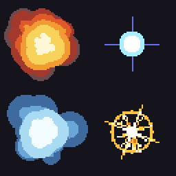

# Free Pixel Effects for Godot 4

30 one-shot pixel art effects: 12 explosions, 10 hit sparks and 8 magic bursts, from 16 to 64 px, in six palettes. Each one is a PNG sprite sheet with a ready Godot `SpriteFrames` file (`.tres`) and a JSON file next to it. CC0, so use them anywhere, commercial included, no credit needed.

## Use one

1. From the Asset Library the effects land in `addons/free_pixel_effects/`.
2. Add an `AnimatedSprite2D` and drag an effect's `.tres` onto Sprite Frames.
3. Call `play()` or turn on Autoplay. It plays once; connect `animation_finished` to `queue_free` to clean up.
4. Set Texture Filter to Nearest so the pixels stay sharp.

Full notes are in `addons/free_pixel_effects/README.md`. Loads and plays in Godot 4.3, 4.5 and 4.7.

## Want the rest?

The same style runs to 54 battle effects (slashes, projectiles, spells, heals, buffs and debuffs, portals, explosions) at 32, 48 and 64 px, each with a SpriteFrames file, in the paid [Complete Collection](https://cs5475.itch.io/pixel-battle-effects-complete) on itch.io.

The effects are drawn by code with [Puff](https://cs5475.itch.io/puff). The code was written with help from AI; no image-generation AI made the pictures.
